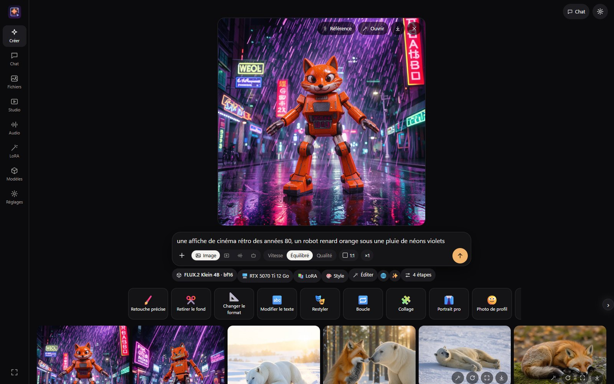
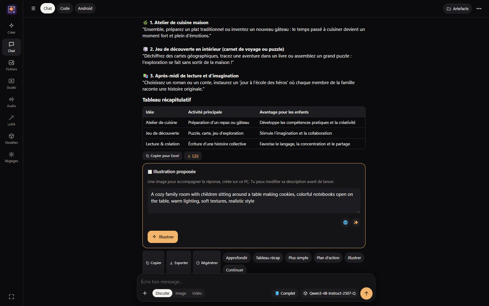
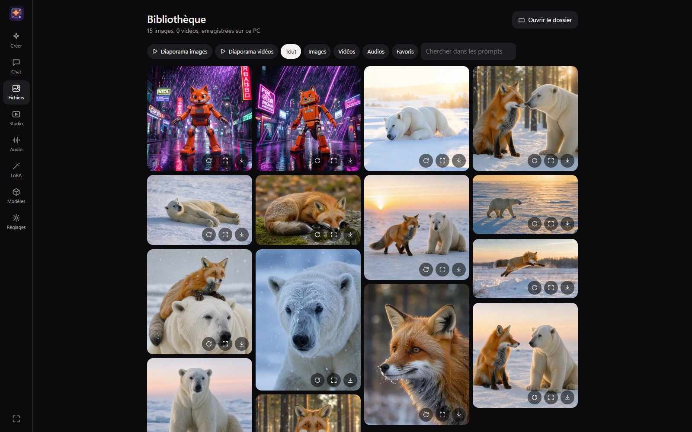
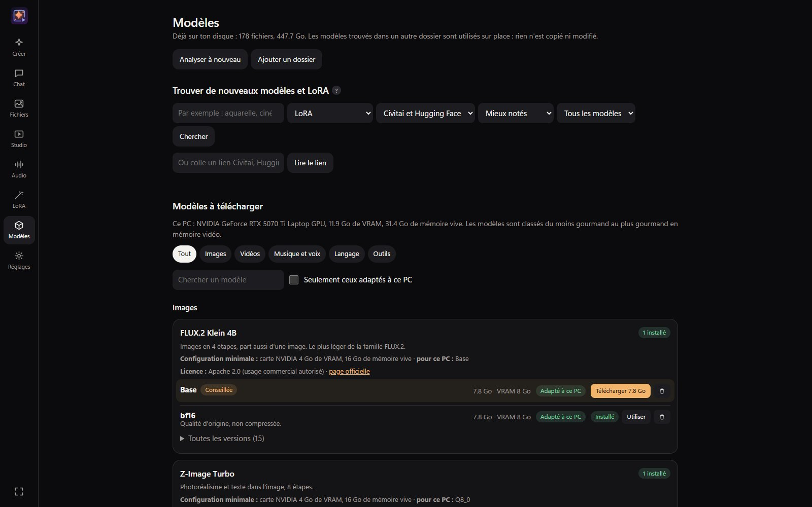

  

<h1 align="center">IA Locale Facile Studio</h1>

  <b>Ton studio de création IA, 100 % sur ton PC.</b> 
  Images, vidéos, chat et audio, sans abonnement, sans cloud, sans compte. 
  L'application s'installe toute seule et choisit les modèles adaptés à ta carte graphique.

  <a href="https://github.com/gm59110-blip/ia-locale-facile-studio/releases/latest/download/IA-Locale-Facile-Studio.zip"><b>⬇️ Télécharger la dernière version (gratuite)</b></a> ·
  <a href="https://www.ia-locale-facile.fr/ia-locale-facile-studio?utm_source=github&utm_medium=readme&utm_campaign=readme-studio">Présentation et captures sur www.ia-locale-facile.fr</a>

## Pourquoi IA Locale Facile Studio ?

- **Tout reste chez toi.** Tes prompts, tes images et tes conversations ne quittent jamais ton PC. Une fois les modèles
  téléchargés, l'application fonctionne **sans Internet**.
- **Pas d'abonnement, pas de crédits.** Tu crées autant que tu veux : seule ta carte graphique travaille.
- **Zéro configuration.** Pas de ligne de commande, pas de nœuds à brancher : un double-clic sur `Demarrer.cmd`,
  l'application prépare tout et te propose les modèles qui tournent bien sur ta machine.
- **Des modèles récents et libres.** FLUX.2 Klein, Wan 2.2, Qwen3… téléchargés depuis les pages officielles de leurs
  auteurs, avec leur licence affichée.
- **Propre.** Tout est installé dans le dossier de l'application : pour désinstaller, tu supprimes le dossier.

## Ce que tu peux faire

| | |
|---|---|
| 🎨 **Créer** | Images à partir d'un texte, en français : le prompt est traduit et enrichi pour le modèle. Styles prêts à l'emploi, formats, file d'attente, image de référence en un clic. |
| ✏️ **Retoucher** | Retouche précise, retirer le fond, changer le format, modifier le texte d'une image, restyler, portrait pro, photo de profil… |
| 🎬 **Vidéo** | Courtes vidéos à partir d'un texte ou d'une image (Wan 2.2). |
| 💬 **Chat** | Un assistant de conversation local : réponses structurées, tableaux, export PDF/Word/Excel, et il peut te proposer un prompt d'image prêt à lancer. |
| 🖼️ **Bibliothèque** | Toutes tes créations, avec leur prompt, favoris, recherche et diaporama. |
| 🎞️ **Studio** | Mini-films et mangas : chaque plan part de la dernière image du précédent, pour garder la continuité. |
| 🎵 **Audio** | Musique, voix off, effets sonores et génériques, avec édition et export MP3, selon les modèles installés. |

<table>
  <tr>
    <td></td>
    <td></td>
  </tr>
  <tr>
    <td align="center"><i>Le chat, 100 % local</i></td>
    <td align="center"><i>La bibliothèque</i></td>
  </tr>
</table>

## Configuration nécessaire

- **Windows 10 ou 11** (64 bits).
- **Carte graphique NVIDIA** avec au moins **6 Go** de mémoire vidéo (8 Go ou plus conseillés). Les cartes Intel Arc
  sont prises en charge à titre expérimental.
- **16 Go** de mémoire vive, **40 Go** d'espace disque libre.
- Une connexion Internet **pour l'installation** et le téléchargement des modèles seulement.

## Installation

1. Télécharge [**`IA-Locale-Facile-Studio.zip`**](https://github.com/gm59110-blip/ia-locale-facile-studio/releases/latest/download/IA-Locale-Facile-Studio.zip) (toujours la dernière version ;
   le détail de chaque version est dans la page [**Releases**](../../releases/latest) et dans le [journal des modifications](CHANGELOG.md)).
2. Décompresse-le où tu veux (par exemple dans `Documents`). Évite `Program Files`.
3. Ouvre le dossier et double-clique sur **`Demarrer.cmd`**.
   Windows peut afficher un avertissement pour un fichier venu d'Internet : clique sur « Informations complémentaires »
   puis « Exécuter quand même ». Le fichier est court et lisible : tu peux l'ouvrir avec le Bloc-notes pour voir ce
   qu'il fait.
4. La première fois, l'application prépare son propre Python, puis s'ouvre et te propose d'installer le moteur et les
   modèles choisis pour ton PC. Compte de 20 minutes à une heure selon ta connexion.

Les fois suivantes, `Demarrer.cmd` ouvre l'application en quelques secondes, **même hors ligne**.

<b>Pour les utilisateurs avancés</b>

- L'application crée son **propre environnement Python isolé** dans son dossier (`runtime/` et `.venv/`) : ton Python,
  tes variables d'environnement et tes autres outils IA ne sont ni modifiés ni utilisés.
- Le moteur de génération est **ComfyUI** (logiciel libre, GPL-3.0), téléchargé dans `engine/` à une version figée et
  testée. Le chat utilise **llama.cpp**.
- Les modèles déjà présents sur ton disque (dossiers ComfyUI, Forge, etc.) peuvent être **détectés et utilisés sur place**,
  sans copie (édition Premium).
- Les créations sont **marquées comme générées par IA** (métadonnées et filigrane invisible), comme l'exige le règlement
  européen sur l'IA.
- Vérifie l'intégrité du zip avec le fichier `.sha256.txt` publié à côté :
  `certutil -hashfile IA-Locale-Facile-Studio.zip SHA256`.

## Éditions

| | Gratuite | Premium |
|---|---|---|
| **Prix** | Gratuite, sans limite de durée | **Bientôt disponible** : 19,99 € en prix de lancement, puis 29,99 €. Paiement unique, sans abonnement |
| **Images** | FLUX.2 Klein 4B, Stable Diffusion 1.5, SDXL | tous les modèles du catalogue (Z-Image Turbo, FLUX.1 schnell, FLUX.2 Klein Base…) |
| **Vidéos** | Wan 2.2 (5B) | les autres modèles vidéo du catalogue |
| **Modèles** | catalogue gratuit | recherche sur Hugging Face et Civitai, installation manuelle, import, dossiers de modèles existants |
| **Fonctions** | création, retouche, traduction du prompt, chat, bibliothèque | LoRA, séries d'images, atelier LoRA, assistant de code et applis Android, accès depuis le téléphone, options administrateur |

**L'édition gratuite est la version d'essai** : même moteur, même installation, même interface. Si elle fonctionne sur
ton PC, l'édition Premium y fonctionnera aussi. L'édition Premium s'achètera directement dans l'application
(Réglages > Licence) et s'installera toute seule après le paiement.

## Modèles et licences

L'application ne contient aucun modèle : elle propose des liens vers les pages officielles de leurs auteurs. Chaque
modèle a sa propre licence, affichée avant le téléchargement quand elle pose des conditions. Les modèles sous licence
non commerciale ne sont pas proposés en téléchargement.

## Questions fréquentes

**Est-ce que mes images partent sur Internet ?**
Non. Tout est calculé sur ton PC. L'application ne se connecte que pour télécharger le moteur et les modèles, et quand tu
le demandes (mise à jour des modèles, achat de l'édition Premium).

**Ça marche sans carte NVIDIA ?**
Les cartes Intel Arc sont prises en charge à titre expérimental. Sans carte graphique compatible, seuls le chat et la
bibliothèque fonctionnent. Essaie l'édition gratuite : elle te le dira.

**Comment désinstaller ?**
Ferme l'application et supprime son dossier. Rien n'est installé ailleurs sur le PC.

**Y a-t-il une assistance ?**
L'application est fournie en l'état, sans assistance. Des tutoriels et des tests de matériel sont publiés sur
[www.ia-locale-facile.fr](https://www.ia-locale-facile.fr).

## Pour aller plus loin

- [Le guide complet de l'application](https://www.ia-locale-facile.fr/post/ia-locale-facile-studio-appli-ia-locale?utm_source=github&utm_medium=readme&utm_campaign=readme-guide) : toutes les fonctions, écran par écran.
- [Pinokio, Stability Matrix ou IA Locale Facile Studio : lequel choisir ?](https://www.ia-locale-facile.fr/post/pinokio-stability-matrix-ou-studio-comparatif?utm_source=github&utm_medium=readme&utm_campaign=readme-comparatif) : un comparatif honnête, avec les limites de chacun.
- [Quelle RTX pour l'IA locale ?](https://www.ia-locale-facile.fr/post/comparatif-rtx-pour-la-génération-d-image-et-de-vidéo-ia-locale?utm_source=github&utm_medium=readme&utm_campaign=readme-rtx) : quelle carte graphique choisir.

## Documents

- [Licence d'utilisation](docs/LICENCE-UTILISATEUR.md)
- [Conditions générales de vente](docs/CGV.md)
- [Confidentialité](docs/CONFIDENTIALITE.md)
- [Mentions légales](docs/MENTIONS-LEGALES.md)
- [Logiciels et modèles tiers](THIRD_PARTY_NOTICES.md)

---

*English: IA Locale Facile Studio is a fully local AI creation studio for Windows (images, video, chat, audio). No
subscription, no cloud: everything runs on your own NVIDIA GPU. The interface is available in English, German and
Spanish (Settings > Language). Download the free edition: [IA-Locale-Facile-Studio.zip](https://github.com/gm59110-blip/ia-locale-facile-studio/releases/latest/download/IA-Locale-Facile-Studio.zip).*

IA Locale Facile Studio est un logiciel propriétaire, gratuit dans son édition gratuite. Le code n'est pas libre :
voir la [licence d'utilisation](docs/LICENCE-UTILISATEUR.md). Les noms de modèles et de logiciels cités appartiennent à
leurs propriétaires ; l'application n'est affiliée à aucun d'eux.
